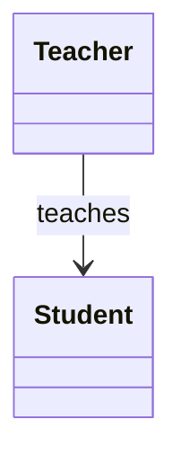
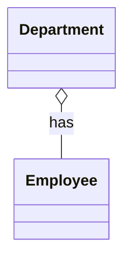
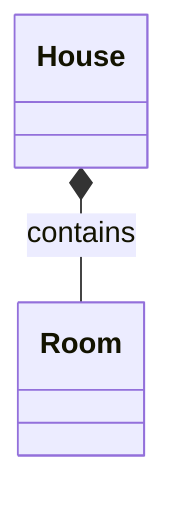

# Association, Aggregation, and Composition in Java

## 1. Introduction

In Java, objects often need to interact with each other to perform a task.

For example:
- A teacher teaches students.
- A department has employees.
- A house contains rooms.

These relationships are explained using **Association, Aggregation, and Composition**.

All three describe relationships between objects, but they differ in how strongly the objects depend on each other.

## 2. Association

### What is Association?

Association is a relationship between two independent objects. One object uses or interacts with another object, but neither object necessarily owns the other.

Both objects can exist independently.

### Real-world example

A teacher teaches a student.

The teacher can exist without the student, and the student can exist without the teacher.

### Diagram



### Java example

```java
class Student {

    String name;

    Student(String name) {
        this.name = name;
    }
}

class Teacher {

    void teach(Student student) {
        System.out.println(
            "Teacher is teaching " + student.name
        );
    }
}

public class Main {

    public static void main(String[] args) {

        Student student = new Student("Rahul");
        Teacher teacher = new Teacher();

        teacher.teach(student);
    }
}
```

**Output:**

```text
Teacher is teaching Rahul
```

### How does it work?

- `Student` and `Teacher` are separate classes.
- The `Teacher` interacts with a `Student` through the `teach()` method.
- The teacher does not create or own the student in this example.
- Both objects can exist independently.

**Remember:** Association describes a general relationship between objects. It does not imply ownership.

---

## 3. Aggregation

### What is Aggregation?

Aggregation is a special type of association in which one object has a reference to another object, but the referenced object can exist independently.

It represents a weak **has-a relationship**.

### Real-world example

A department has employees.

If a department is closed or removed, its employees can still exist and work in another department.

### Diagram



The hollow diamond represents aggregation and is placed on the side of the whole object, in this case `Department`.

### Java example

```java
import java.util.List;

class Employee {

    String name;

    Employee(String name) {
        this.name = name;
    }
}

class Department {

    private List<Employee> employees;

    Department(List<Employee> employees) {
        this.employees = employees;
    }

    void showEmployees() {
        for (Employee employee : employees) {
            System.out.println(employee.name);
        }
    }
}

public class Main {

    public static void main(String[] args) {

        Employee e1 = new Employee("Amit");
        Employee e2 = new Employee("Priya");

        Department department =
            new Department(List.of(e1, e2));

        department.showEmployees();
    }
}
```

**Output:**

```text
Amit
Priya
```

### How does it work?

- The `Employee` objects are created separately.
- The `Department` receives references to those existing employees.
- The employees are not created inside the `Department` constructor.
- The same employees can be referenced by other objects if required.

In this example, the employees can exist independently of the department.

**Remember:** Aggregation represents a whole-part relationship in which the part can exist independently of the whole.

---

## 4. Composition

### What is Composition?

Composition is a stronger type of association in which one object owns or controls the lifecycle of another object.

It also represents a **has-a relationship**, but the contained object is treated as an integral part of the containing object.

### Real-world example

A house has rooms.

In a simple model, rooms are created as part of the house, and they belong to that house. If the house object is no longer used, its rooms are no longer independently managed by the application.

The important point is that this lifecycle relationship is a design choice in the software model, not a rule automatically enforced by Java.

### Diagram



The filled diamond represents composition and is placed on the side of the whole object, in this case `House`.

### Java example

```java
import java.util.ArrayList;
import java.util.List;

class Room {

    private String name;

    Room(String name) {
        this.name = name;
    }

    void showRoom() {
        System.out.println(name);
    }
}

class House {

    private List<Room> rooms = new ArrayList<>();

    House() {
        rooms.add(new Room("Bedroom"));
        rooms.add(new Room("Kitchen"));
        rooms.add(new Room("Living Room"));
    }

    void showRooms() {
        for (Room room : rooms) {
            room.showRoom();
        }
    }
}

public class Main {

    public static void main(String[] args) {

        House house = new House();

        house.showRooms();
    }
}
```

**Output:**

```text
Bedroom
Kitchen
Living Room
```

### How does it work?

- The `House` creates its `Room` objects internally.
- The rooms are managed as parts of the house in this model.
- The `Room` objects are not passed in from outside.
- The `House` controls how these rooms are created and managed.

**Remember:** Composition represents a strong whole-part relationship in which the whole is responsible for managing the parts.

One important Java detail: composition does not automatically destroy an object when its owner becomes unreachable. Java uses garbage collection, and an object can remain alive if other reachable objects still hold references to it.

---

## 5. Association vs Aggregation vs Composition

| Feature | Association | Aggregation | Composition |
|---|---|---|---|
| Relationship | General interaction | Weak has-a | Strong has-a |
| Ownership | Not implied | Weak or shared grouping | Strong ownership |
| Independent existence | Both objects can exist independently | Part can exist independently | Part is modeled as belonging to the whole |
| Object creation | Independent or shared | Part is often created separately | Whole often creates or manages the part |
| UML symbol | Ordinary line or arrow | Hollow diamond | Filled diamond |
| Example | Teacher and student | Department and employee | House and room |

These are common design interpretations. Java itself does not enforce aggregation or composition as special language features. The relationship depends on how the classes are designed and how their objects are managed.

---

## 6. One Easy Way to Remember

Think about these three examples:

**Association:** A doctor treats a patient.

The doctor and patient exist independently. The relationship describes their interaction.

**Aggregation:** A team has players.

Players can exist independently of a particular team and may join another team.

**Composition:** An order contains order items.

In a typical order-management system, an order item belongs to a particular order. The order manages its items, and the items are not usually treated as independent business records.

---

## 7. Real-World Examples in Java Applications

### Association

In a Spring Boot application, a controller calls a service to process a request. The controller and service are separate objects that interact with each other.

### Aggregation

A department object refers to employee objects that are managed independently. Employees can be reassigned without needing to recreate them.

### Composition

An order object contains line items that are created and managed as part of that order. If the order is removed from the application, its line items may also be removed according to the application's data-management rules.

These examples describe common designs. The actual relationship depends on the application requirements.

---


## 9. My Interview Understanding

Association, aggregation, and composition describe relationships between objects.

Association is a general relationship, such as a teacher teaching a student. Aggregation is a weak has-a relationship, such as a department having employees who can exist independently. Composition is a stronger has-a relationship, such as an order containing order items that are managed as part of that order.

The main difference is the level of ownership and how the related objects are managed. Java does not enforce these relationships automatically, so we express them through our class design.
