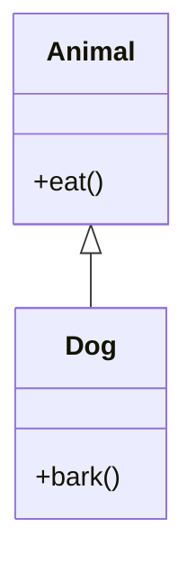
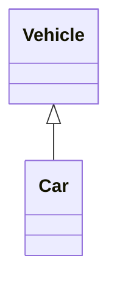
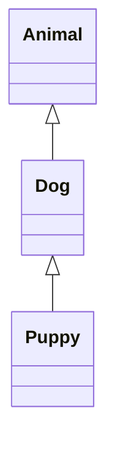
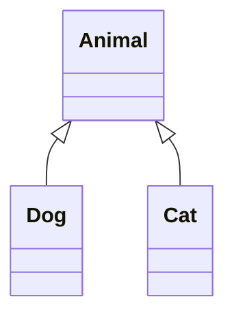
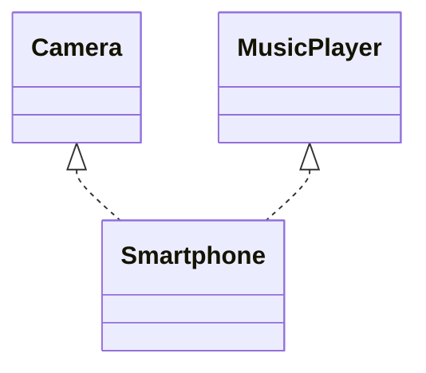
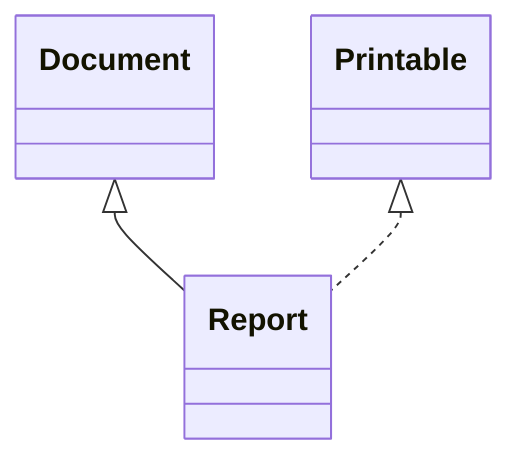

# Inheritance in Java

## 1. What is Inheritance?

Inheritance is an OOP concept in which one class acquires the properties and behaviors of another class.

The class whose properties are inherited is called the **parent class** or **superclass**. The class that inherits them is called the **child class** or **subclass**.

In Java, we use the `extends` keyword to inherit a class.

**Why do we use inheritance?**

- To reuse existing code.
- To reduce code duplication.
- To extend the functionality of an existing class.
- To support runtime polymorphism through method overriding.

### Real-World Example

Consider a banking application.

A general `Account` class can contain common operations such as depositing and checking the balance. Different account types, such as `SavingsAccount` and `CurrentAccount`, can inherit these common operations and provide their own additional behavior.

## 2. Basic Inheritance Example

```java
class Animal {

    void eat() {
        System.out.println("Animal is eating");
    }
}

class Dog extends Animal {

    void bark() {
        System.out.println("Dog is barking");
    }
}

public class Main {

    public static void main(String[] args) {

        Dog dog = new Dog();

        dog.eat();  // Inherited from Animal
        dog.bark(); // Defined in Dog
    }
}
```

**Output:**

```text
Animal is eating
Dog is barking
```

### How does it work?

The `Dog` class extends the `Animal` class. Therefore, a `Dog` object can call the inherited `eat()` method as well as its own `bark()` method.

### Inheritance Diagram



Here, `Animal` is the parent class and `Dog` is the child class.

## 3. Types of Inheritance in Java

Java class inheritance is commonly explained through five types:

1. Single Inheritance
2. Multilevel Inheritance
3. Hierarchical Inheritance
4. Multiple Inheritance
5. Hybrid Inheritance

Java supports single, multilevel, and hierarchical inheritance through classes. It does not support multiple inheritance through classes, but similar combinations of behavior can be achieved using interfaces.

### 3.1 Single Inheritance

One child class inherits from one parent class.

**Example:**

```java
class Vehicle {

    void start() {
        System.out.println("Vehicle is starting");
    }
}

class Car extends Vehicle {

    void drive() {
        System.out.println("Car is moving");
    }
}
```

**Diagram:**



**Real-world example:** A `Car` inherits common vehicle behavior such as starting from the `Vehicle` class.

### 3.2 Multilevel Inheritance

A class inherits from a child class, creating a chain of inheritance.

**Example:**

```java
class Animal {

    void eat() {
        System.out.println("Eating");
    }
}

class Dog extends Animal {

    void bark() {
        System.out.println("Barking");
    }
}

class Puppy extends Dog {

    void weep() {
        System.out.println("Puppy is whining");
    }
}
```

**Diagram:**



**Real-world example:** A `Puppy` can access eligible inherited methods from both `Dog` and `Animal`.

### 3.3 Hierarchical Inheritance

Multiple child classes inherit from the same parent class.

**Example:**

```java
class Animal {

    void eat() {
        System.out.println("Animal is eating");
    }
}

class Dog extends Animal {

    void bark() {
        System.out.println("Dog is barking");
    }
}

class Cat extends Animal {

    void meow() {
        System.out.println("Cat is meowing");
    }
}
```

**Diagram:**



**Real-world example:** Both `Dog` and `Cat` inherit common behavior from `Animal`, but each has its own specific behavior.

### 3.4 Multiple Inheritance

Multiple inheritance means one child inherits from more than one parent.

Java does not allow a class to extend two classes.

**Invalid example:**

```java
class Father {
    void show() {}
}

class Mother {
    void display() {}
}

// Compilation error
class Child extends Father, Mother {
}
```

This is invalid Java syntax.

However, Java allows a class to implement multiple interfaces.

**Example:**

```java
interface Camera {

    void takePhoto();
}

interface MusicPlayer {

    void playMusic();
}

class Smartphone implements Camera, MusicPlayer {

    @Override
    public void takePhoto() {
        System.out.println("Taking photo");
    }

    @Override
    public void playMusic() {
        System.out.println("Playing music");
    }
}
```

**Diagram:**



**Real-world example:** A smartphone can support camera and music-player capabilities through separate interfaces.

### 3.5 Hybrid Inheritance

Hybrid inheritance combines two or more types of inheritance.

Java does not support every hybrid structure through classes alone when it requires multiple inheritance. Interfaces can be used to create supported combinations.

**Example:**

```java
interface Printable {

    void print();
}

class Document {

    void open() {
        System.out.println("Opening document");
    }
}

class Report extends Document implements Printable {

    @Override
    public void print() {
        System.out.println("Printing report");
    }
}
```

**Diagram:**



Here, `Report` inherits from `Document` and implements the `Printable` interface.

## 4. Important Keywords Used in Inheritance

### `extends`

Used when one class inherits from another class.

```java
class Dog extends Animal {
}
```

### `implements`

Used when a class provides implementations for an interface's contract.

```java
class MyService implements Runnable {
    @Override
    public void run() {
        System.out.println("Task running");
    }
}
```

### `super`

Used to access eligible parent-class members or call a parent-class constructor.

**Example:**

```java
class Employee {

    String name = "Employee";

    Employee() {
        System.out.println("Employee constructor");
    }
}

class Developer extends Employee {

    Developer() {
        super();
        System.out.println("Developer constructor");
    }

    void display() {
        System.out.println(super.name);
    }
}
```

The `super()` constructor call invokes the parent constructor. When used explicitly, it must be the first statement in the constructor.

## 5. Constructor Execution in Inheritance

When a child object is created, its parent constructor runs before the child constructor.

```java
class Parent {

    Parent() {
        System.out.println("Parent constructor");
    }
}

class Child extends Parent {

    Child() {
        System.out.println("Child constructor");
    }
}

public class Main {

    public static void main(String[] args) {
        Child child = new Child();
    }
}
```

**Output:**

```text
Parent constructor
Child constructor
```

This happens because Java initializes the parent part of the object before completing the child-class initialization.

## 6. Method Overriding Through Inheritance

Inheritance also allows a child class to provide its own implementation of a method inherited from its parent.

```java
class Animal {

    void sound() {
        System.out.println("Animal makes a sound");
    }
}

class Dog extends Animal {

    @Override
    void sound() {
        System.out.println("Dog barks");
    }
}
```

When `sound()` is called on a `Dog` object, the overridden method in `Dog` executes.

This is an example of **runtime polymorphism**.

## 7. Access Modifiers and Inheritance

| Modifier | Accessible in a subclass in another package? |
|---|---|
| `public` | Yes |
| `protected` | Yes, subject to Java's protected-access rules |
| Default (package-private) | No, unless the subclass is in the same package |
| `private` | Not directly accessible |

A child class does not get direct access to private members of its parent. Those members still belong to the parent portion of the object, and the parent can expose controlled access through public or protected methods.

## 8. Advantages of Inheritance

- **Code reuse:** Common functionality can be written once in the parent class.
- **Maintainability:** Shared behavior can be updated in one place.
- **Extensibility:** Child classes can add or customize behavior.
- **Runtime polymorphism:** Parent references can work with different child objects.

## 9. Disadvantages of Inheritance

- **Tight coupling:** Changes to a parent class can affect child classes.
- **Complexity:** Deep inheritance chains can be difficult to understand.
- **Incorrect relationships:** Inheritance is a poor choice when the child is not genuinely a type of the parent.

Use inheritance when an **is-a relationship** makes sense. For example, a `Dog` is an `Animal`. If one class simply needs to use another class's functionality, composition may be a better choice.

## 10. Real-World Examples

| Parent class | Child class | Shared or specialized behavior |
|---|---|---|
| `Vehicle` | `Car` | Starting and driving |
| `Employee` | `Developer` | Employee details and coding responsibilities |
| `Account` | `SavingsAccount` | Common account operations and savings-specific rules |
| `Notification` | `EmailNotification` | Common notification contract and email delivery |
| `Shape` | `Circle` | Common shape behavior and circle-specific calculations |

These are design examples. In a real application, the exact inheritance structure depends on the requirements.

## 11. Interview Questions

1. What is inheritance in Java, and why do we use it?
2. What is the difference between `extends` and `implements`?
3. Why does Java not support multiple inheritance through classes?
4. What is the difference between inheritance and composition?
5. Can a child class access private members of its parent?
6. What is the purpose of the `super` keyword?
7. In what order do parent and child constructors execute?
8. Can constructors be inherited or overridden?
9. What is the relationship between inheritance and runtime polymorphism?
10. Why should we avoid deep inheritance hierarchies?

## 12. My Interview Understanding

I understand inheritance as a way to reuse and extend the behavior of an existing class. In Java, a child class uses the `extends` keyword to inherit from a parent class.

For example, in a banking application, a general `Account` class can contain common functionality such as checking the balance. A `SavingsAccount` class can inherit that functionality and add savings-specific rules.

I would use inheritance when there is a genuine is-a relationship. If I only need to use another class's functionality without establishing that relationship, I would consider composition instead.
