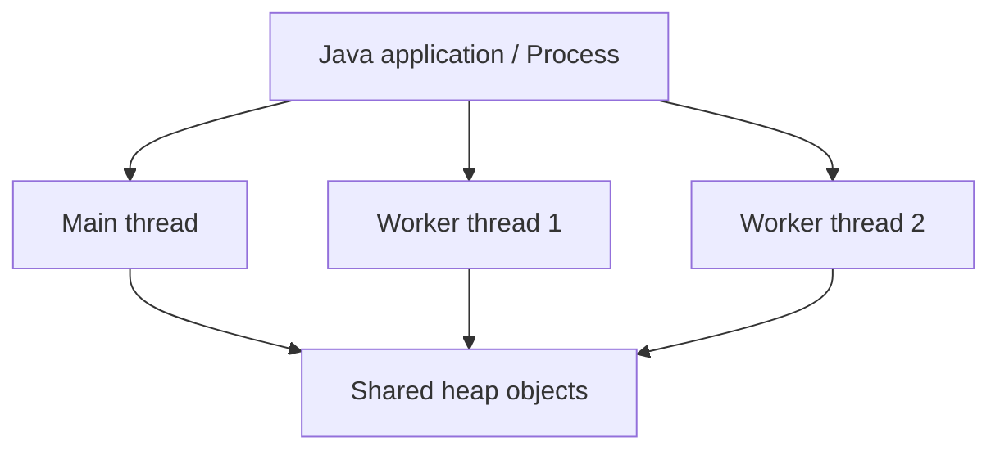

# 1. Multithreading Basics

## What is a thread?

A thread is a path of execution inside a program. A Java application can use multiple threads to do different tasks.

**Simple example:** In a food delivery application, one task may fetch restaurant details while another task processes a notification.

## Process vs thread

| Process | Thread |
|---|---|
| A running application | A unit of execution inside a process |
| Has its own memory space | Threads in one process share heap memory |
| Usually heavier to create | Usually lighter than a process |

## Diagram



Threads share heap objects, so shared mutable data must be handled carefully.

## Create a thread using Runnable

```java
public class ThreadExample {
    public static void main(String[] args) {
        Runnable task = () ->
            System.out.println("Task running on " +
                               Thread.currentThread().getName());

        Thread thread = new Thread(task);
        thread.start();

        System.out.println("Main running on " +
                           Thread.currentThread().getName());
    }
}
```

**Important:** `start()` asks the JVM to start a new thread. Calling `run()` directly is just a normal method call on the current thread.

The output order can vary because thread scheduling is not guaranteed.

## Why use multithreading?

- Handle independent tasks at the same time.
- Improve responsiveness.
- Make better use of available CPU cores for suitable work.
- Process background tasks without blocking the main flow.

## Interview questions

1. What is the difference between a process and a thread?
2. What happens when we call `start()` versus `run()`?
3. Do threads always make an application faster? **No.** Thread coordination has overhead, and too many threads can reduce performance.
