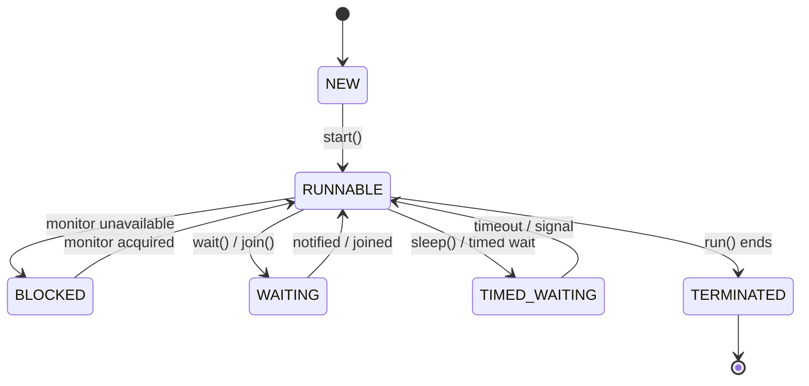

# 2. Thread Lifecycle and States

Java defines these `Thread.State` values:

- `NEW`: thread object created, but `start()` has not been called.
- `RUNNABLE`: eligible to run or running; Java does not expose a separate `RUNNING` state.
- `BLOCKED`: waiting to enter a synchronized block or method because another thread owns that monitor.
- `WAITING`: waiting indefinitely for another thread's action, such as through `wait()` or `join()` without a timeout.
- `TIMED_WAITING`: waiting for a limited time, such as `sleep(1000)`.
- `TERMINATED`: execution has finished.

## Diagram



This is a learning diagram, not every possible transition. Actual transitions depend on the operation and scheduling.

## Check a thread state

```java
Thread t = new Thread(() -> System.out.println("Working"));
System.out.println(t.getState()); // NEW
t.start();
```

The state after `start()` can change quickly, so don't rely on a specific state at an arbitrary moment.

## Interview questions

- Is `RUNNING` a Java `Thread.State`? No.
- Can a terminated thread be started again? No; create a new `Thread`.
- Does `sleep()` release a synchronized monitor? No.
