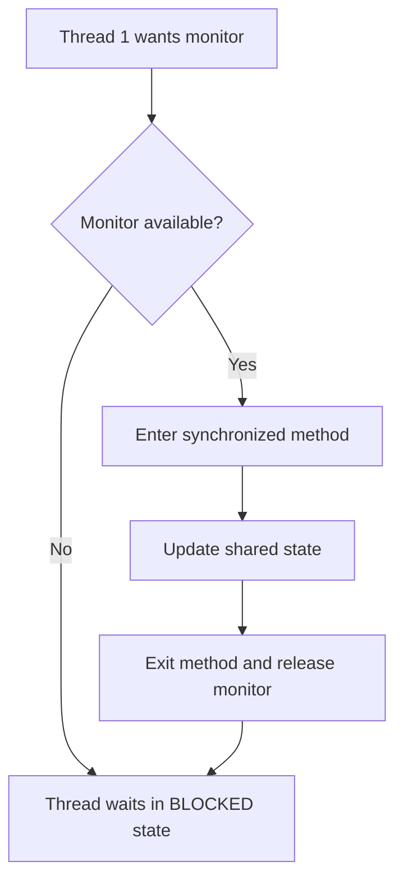

# 4. Synchronization and `synchronized`

## What is synchronization?

Synchronization controls access to shared mutable data so that only one thread at a time can execute a particular synchronized section protected by the same monitor.

**Example:** Two threads try to withdraw money from the same bank account. We need to prevent unsafe simultaneous updates.

## Example

```java
class Counter {
    private int count = 0;

    public synchronized void increment() {
        count++;
    }

    public int getCount() {
        return count;
    }
}
```

`count++` is a read-modify-write operation, not one indivisible operation. Synchronization protects it when all increments use the same `Counter` object's monitor.

## Diagram



## Object lock vs class lock

- Instance synchronized method locks the current object (`this`).
- Static synchronized method locks the `Class` object.
- Different object monitors are different locks.

## Important points

- Synchronization helps with mutual exclusion and memory visibility.
- It can reduce concurrency if the critical section is too large.
- It does not automatically prevent deadlocks.
- Every thread accessing the same mutable data must follow the same coordination strategy.

## Interview question

**Can two threads execute two synchronized instance methods on the same object simultaneously?** Not while both methods require that same object's monitor. They can execute synchronized methods on different objects simultaneously.
