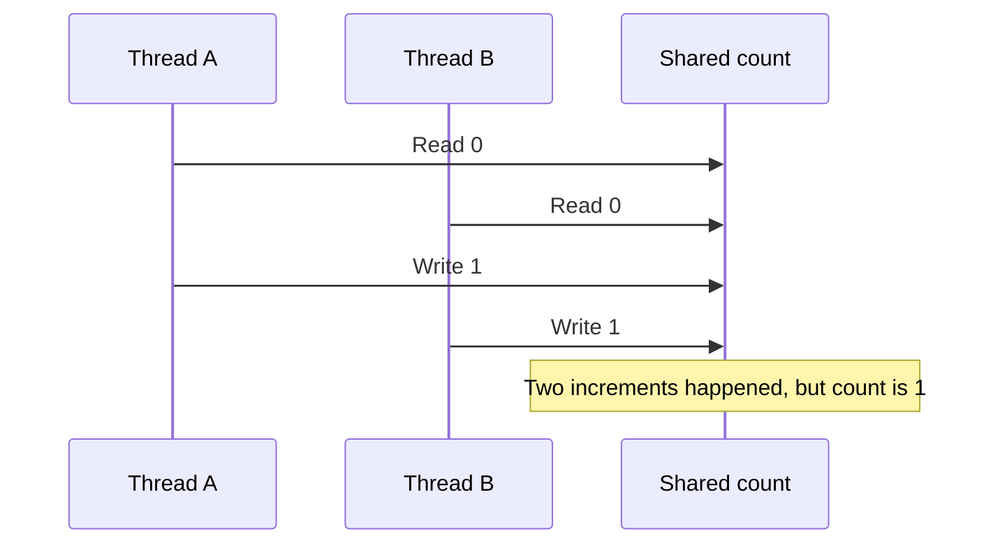

# 5. Race Condition

## What is a race condition?

A race condition happens when the result depends on the timing or interleaving of multiple threads accessing shared state.

## Example

```java
class Counter {
    int count = 0;

    void increment() {
        count++; // not atomic
    }
}
```

If two threads call `increment()` many times, the final count may be less than expected because both can read the same old value and overwrite each other's updates.

## Fix 1: synchronized

```java
class SafeCounter {
    private int count;

    synchronized void increment() {
        count++;
    }

    synchronized int getCount() {
        return count;
    }
}
```

## Fix 2: AtomicInteger

```java
import java.util.concurrent.atomic.AtomicInteger;

class AtomicCounter {
    private final AtomicInteger count = new AtomicInteger();

    void increment() {
        count.incrementAndGet();
    }

    int getCount() {
        return count.get();
    }
}
```

## Diagram



## Interview distinction

A race condition is the bug. A data race is a specific situation involving unsynchronized conflicting accesses to shared memory, at least one of which is a write. The terms are related but not identical.
