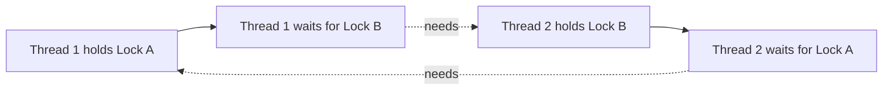

# 6. Deadlock

## What is deadlock?

Deadlock occurs when threads wait forever for locks held by one another, so none can continue.

## Example scenario

- Thread 1 holds Lock A and waits for Lock B.
- Thread 2 holds Lock B and waits for Lock A.

## Four conditions associated with deadlock

1. **Mutual exclusion:** a resource can be held by one thread at a time.
2. **Hold and wait:** a thread holds one resource while waiting for another.
3. **No preemption:** a resource cannot simply be taken away.
4. **Circular wait:** a cycle of threads waits for resources held by the next thread.

Breaking at least one condition can prevent this classic deadlock pattern.

## How to reduce deadlock risk

- Acquire multiple locks in a consistent global order.
- Keep synchronized sections small.
- Avoid calling unknown/external code while holding a lock.
- Consider `ReentrantLock.tryLock()` with a timeout where appropriate.
- Use thread dumps to diagnose a production deadlock.

## Interview question

**Does `sleep()` fix deadlock?** No. Sleeping does not release a monitor held by a synchronized block.
