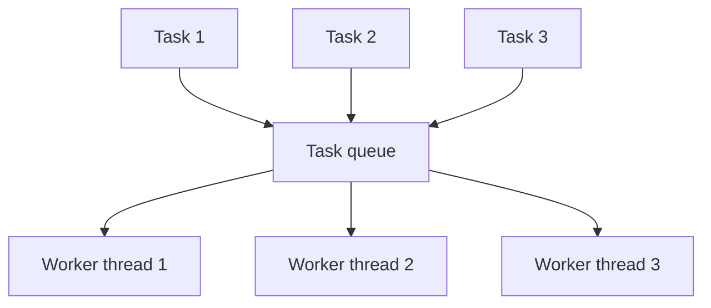

# 12. Thread Pools

## What is a thread pool?

A thread pool keeps a set of worker threads and reuses them to execute submitted tasks. This avoids creating a brand-new thread for every small task.

## Diagram

## Common pool types

- `newFixedThreadPool(n)`: fixed number of workers, shared unbounded queue.
- `newSingleThreadExecutor()`: one worker, tasks run sequentially.
- `newCachedThreadPool()`: can create many threads as needed and reuses idle ones; can grow very large.
- `ScheduledExecutorService`: schedules delayed or repeated tasks.
- `ForkJoinPool`: designed for tasks that can be split into smaller tasks and joined.

## How to choose pool size?

There is no one correct number for every application.

- CPU-bound work: start around the number of available CPU cores and benchmark.
- I/O-bound work: tasks spend time waiting, so a larger pool may help, but database connections, remote-service limits and memory must be considered.
- Monitor queue length, active threads, task latency, failures and rejections.

For controlled production behavior, configure maximum pool size, queue capacity, thread names and a rejection policy.
