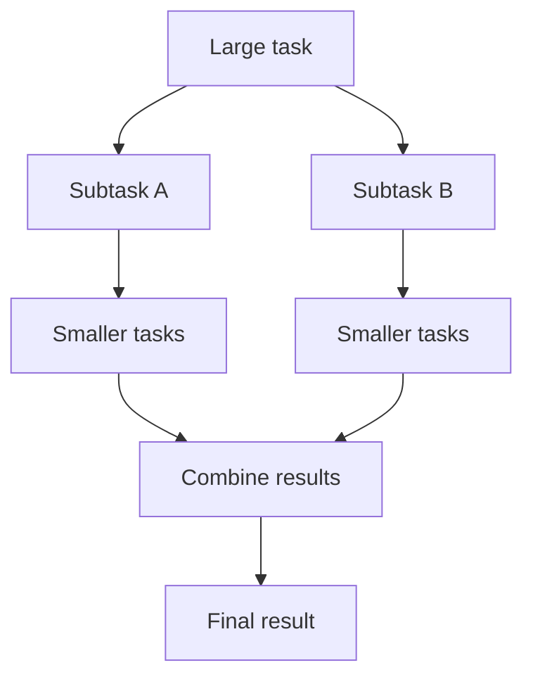

# 16. ForkJoinPool

## What is ForkJoinPool?

`ForkJoinPool` is designed for tasks that can be split into smaller subtasks (**fork**) and whose results can later be combined (**join**). It uses work-stealing to balance tasks among worker threads.

## Diagram

## When is it useful?

Examples include recursive array processing, parallel divide-and-conquer algorithms and some CPU-intensive computations.

## Common pool

Java provides a common `ForkJoinPool` used by some APIs, including many parallel-stream operations and default async `CompletableFuture` operations. Blocking tasks can reduce its effectiveness, so do not casually use it for long blocking I/O.

## Interview question

**How is it different from a regular thread pool?** ForkJoinPool is optimized for many small tasks that split recursively and can be stolen by idle workers. A regular executor is a more general task-execution mechanism.
